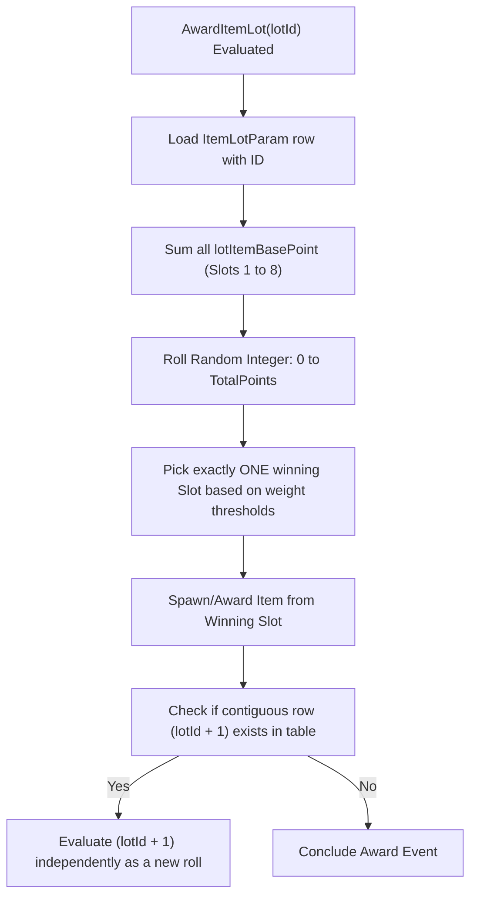

# LootForge: Critical Research — Boss Drop & Loot Table Engine Mechanics

**Status**: CRITICAL CORE RESEARCH  
**Date**: 2026-10-12  
**Target Engine**: FromSoftware Souls / Dantelion 64-bit Engine (*Elden Ring* v1.12+ / Shadow of the Erdtree)  
**Target Subsystem**: LootForge (`regulation.bin`, `Paramdex`, ModEngine 3)  
**Author**: Antigravity / The Order Operations  

---

> [!CRITICAL]
> ## THE SOULS ENGINE SINGLE-ROLL MULTI-SLOT TRAP
> In FromSoftware's Souls engine, populating multiple slots (e.g. `lotItemId01`, `lotItemId02`, `lotItemId03`...) within a single `ItemLotParam` row **DOES NOT DROP MULTIPLE ITEMS**.  
> A single row is evaluated by the engine as a single-roll weighted lottery where all populated slots compete against each other based on `lotItemBasePoint`. The engine rolls a single die and awards at most **ONE** item from that row per event evaluation.  
> 
> To guarantee multiple simultaneous item drops from an encounter (such as a dungeon boss awarding a talisman, a remembrance, and bonus progression armaments), the engine requires **contiguous chained row IDs** (`baseLotId`, `baseLotId + 1`, `baseLotId + 2`, `baseLotId + 3`...).

---

## 1. Problem Statement & Initial Defect

During live testing of LootForge boss progression loot pools, defeating dungeon bosses—specifically the Beastman of Farum Azula in Groveside Cave, which awards the Flamedrake Talisman—resulted in only the vanilla talisman dropping. Despite high-tier boss weapon loot pools being configured, no weapons were awarded upon the boss's defeat banner.

A full reverse-engineering investigation into decrypted `regulation.bin` tables, EMEVD map event scripts (`m60_37_42_00.emevd.dcx`), and memory structures revealed two foundational architectural realities of the FromSoftware engine:

1. **Bosses Drop via Map Events (`ItemLotParam_map`), Not Character Drops (`ItemLotParam_enemy`)**:
   Almost all boss encounters are executed by map ESD/EMEVD event scripts invoking `AwardItemLot(lotId)` pointing to `ItemLotParam_map`. Only 17 vanilla entities in the entire base game award 100% weapon or talisman drops through `ItemLotParam_enemy`.
2. **Contiguous Sequential Chaining is the Exclusive Mechanism for Multi-Item Event Drops**:
   The engine iterates contiguous IDs sequentially (`baseLotId + 1..N`) when processing an event item lot award until a gap in IDs or an un-triggered event group is reached. Populating slots 01 through 08 in a single row causes the engine to perform a weighted dice roll for *one* of those slots, discarding all others.

---

## 2. Engine Drop Table Anatomy & Mechanics

### 2.1 The Two Item Lot Tables

| Parameter Table | Typical Vanilla Row Count | Primary Engine Usage | Boss Encounter Role |
| :--- | :--- | :--- | :--- |
| **`ItemLotParam_enemy`** | ~4,200 rows | Standard enemy and NPC entity kills. Linked via `NpcParam.itemLotIdEnemy` and `itemLotIdMap`. | **Negligible for Bosses**. Only 17 unique entity drops in the entire base game award 100% weapons or talismans (e.g., Banished Knight Dragon Communion Seal `301000010`, Omenkiller Cleaver `482000600`). |
| **`ItemLotParam_map`** | ~9,200 rows | World treasure pickups, chest contents, quest rewards, and **boss encounter completions**. Invoked directly by EMEVD scripts via opcode `AwardItemLot(lotId)`. | **Exclusively Governs Bosses**. Every dungeon boss, major demigod, field boss, Evergaol boss, and invader uses this table. |

### 2.2 Structure of an `ItemLotParam` Row

Each `ItemLotParam` row (both `_enemy` and `_map`) contains 8 parallel item slots:

```
lotItemId01 .. lotItemId08        : int32   (Item ID from EquipParamWeapon/Custom/Protector/Accessory/Goods)
lotItemCategory01 .. 08           : uint32  (1 = Goods/Key, 2 = Weapon, 4 = Armor/Protector, 8 = Accessory, etc.)
lotItemBasePoint01 .. 08          : uint16  (Lottery weight: 1000 = 100.0% base weight)
lotItemNum01 .. 08                : uint8   (Quantity awarded)
getItemFlagId01 .. 08             : uint32  (Event flag set upon acquisition to prevent duplicate drops)
cumulateLotPoint01 .. 08          : uint16  (Pity roll accumulation counters)
```

### 2.3 The Single-Roll Slot Evaluation Routine

When the engine executes `AwardItemLot(lotId)`, the internal evaluation routine performs the following:



> [!WARNING]
> If a developer attempts to add 3 weapon drops into a single row by writing:
> - `lotItemId01`: Bloodhound's Fang (weight: 1000)
> - `lotItemId02`: Uchigatana (weight: 1000)
> - `lotItemId03`: Claymore (weight: 1000)
>
> The engine will sum the points to 3000, roll between 0 and 3000, and **grant exactly ONE of the three weapons (a 33.3% chance each)**. It will NEVER grant all three.

---

## 3. Evidence from Vanilla Engine Scripts & Parameters

### 3.1 EMEVD Script Decompilation: Groveside Cave Case Study

In map `m60_37_42_00.emevd.dcx` (Limgrave NW / Groveside Cave region):

```python
# Event 1037422610: Beastman of Farum Azula Boss Defeat Handler
def Event_1037422610():
    WaitIfCharacterDead(Character(1037420800))  # Wait for Beastman to reach 0 HP
    PlayAnimation(Character(1037420800), DeathAnim)
    SetEventFlag(1037422610, ON)                # Flag boss as permanently slain
    AwardItemLot(1037420400)                    # Award primary boss lot
```

In `ItemLotParam_map`:
* Row `1037420400` ("Red-Feathered Branchsword" label in Paramdex, used for Beastman of Farum Azula):
  - Slot 1: Item `2040` (Flamedragon/Flamedrake Talisman), Category `4`, BasePoints `1000`, Quantity `1`.
  - Slots 2–8: All `0`.
  - Contiguous row `1037420401` was **empty/nonexistent** in vanilla.

Result: Defeating the Beastman triggered `AwardItemLot(1037420400)`, which evaluated row `1037420400` (Slot 1 dropped the talisman), checked for `1037420401` (not found), and exited.

### 3.2 Proof of Vanilla Chained Lots

Inspection of multi-item drops designed by FromSoftware demonstrates how contiguous chaining is utilized throughout vanilla Elden Ring:

1. **Chapel of Anticipation – Grafted Scion**:
   * Base Row `10030`: Ornamental Straight Sword (`2060000`, Cat 2, 1000 Pts)
   * Chained Row `10031`: Golden Beast Crest Shield (`31060000`, Cat 2, 1000 Pts)
2. **Siofra Aqueduct – Valiant Gargoyles**:
   * Base Row `10100`: Gargoyle's Greatsword (`3190000`, Cat 2, 1000 Pts)
   * Chained Row `10101`: Gargoyle's Twinblade (`10080000`, Cat 2, 1000 Pts)
3. **The Shaded Castle – Elemer of the Briar**:
   * Base Row `10820`: Marais Executioner's Sword (`3150000`, Cat 2, 1000 Pts)
   * Chained Row `10821`: Briar Greatshield (`31200000`, Cat 2, 1000 Pts)
4. **Auriza Hero's Grave – Crucible Knight Ordovis**:
   * Base Row `20100`: Ordovis's Greatsword (`3060000`, Cat 2, 1000 Pts)
   * Chained Row `20101`: Crucible Hornshield (`31120000`, Cat 2, 1000 Pts)

Whenever FromSoftware wanted a boss to drop multiple distinct items, **they explicitly created contiguous sequential IDs**.

---

## 4. Progression Tiering Architecture

To create rich, organic boss loot pools that feel balanced and authentic, bosses and field encounters across the Lands Between are partitioned into four discrete world progression tiers:

### 4.1 Progression Tier Breakdown

```
Tier 1: Early Game
Regions: Limgrave, Weeping Peninsula, Stormveil Castle, Morne
ID Ranges: 10000..20100, 20300..20360, 20600..20630
Curated Weapons: Bloodhound's Fang, Uchigatana, Claymore, Lordsworn's Greatsword, Twinblade, Reduvia, Great Epee, Nagakiba, Grafted Blade Greatsword, Golden Halberd, Nightrider Flail, Dismounter, Zweihander, Morning Star.

Tier 2: Mid Game
Regions: Liurnia of the Lakes, Caelid, Raya Lucaria, Caria Manor, Siofra River, Ainsel River
ID Ranges: 20360..20400
Curated Weapons: Moonveil, Dark Moon Greatsword, Starscourge Greatsword, Godslayer's Greatsword, Carian Knight's Sword, Winged Scythe, Sword of Night and Flame, Cross-Naginata, Greatsword (Guts), Magma Wyrm's Scalesword, Ruins Greatsword, Rotten Battle Hammer, Guardian's Swordspear, Eleonora's Poleblade.

Tier 3: Late Game
Regions: Altus Plateau, Mt. Gelmir, Leyndell Royal Capital, Volcano Manor, Shaded Castle
ID Ranges: 20100..20300, 20400..20470, 20630..20700
Curated Weapons: Blasphemous Blade, Rivers of Blood, Marais Executioner's Sword, Morgott's Cursed Sword, Bolt of Gransax, Ordovis's Greatsword, Godskin Peeler, Godskin Stitcher, Inquisitor's Girandole, Prelate's Inferno Crozier, Siluria's Tree, Vyke's War Spear, Death's Poker.

Tier 4: Endgame
Regions: Mountaintops of the Giants, Consecrated Snowfield, Crumbling Farum Azula, Miquella's Haligtree, Mohgwyn Palace
ID Ranges: 20470..20600
Curated Weapons: Hand of Malenia, Maliketh's Black Blade, Sacred Relic Sword, Mohgwyn's Sacred Spear, Giant-Crusher, Dragon King's Cragblade, Golden Order Greatsword, Zamor Curved Sword, Veteran's Prosthesis, Fallingstar Beast Jaw, Eclipse Shotel, Royal Greatsword.
```

---

## 5. Implementation Specification: `BossLootPoolService`

### 5.1 Injection Algorithm

The injection engine operates on `ItemLotParam_map` through the following deterministic sequence:

1. **Decryption & Deserialization**:
   Decrypt `regulation.bin` using AES-256-CBC with FromSoftware's key and inflate the BND4 archive. Read `ItemLotParam_map.param` and apply `ItemLotParam.xml` definitions.
2. **Boss Encounter Discovery**:
   Scan all rows for 100% drops (`lotItemBasePoint01 >= 1000`) where category is Weapon (`2`) or Accessory/Talisman (`4`). Include hardcoded landmark boss lots (`1037420400`, `20330`, etc.).
3. **Progression Classification**:
   Evaluate row ID and Paramdex row label against substring heuristics (e.g. `haligtree`, `malenia`, `farum azula` -> Tier 4; `altus`, `leyndell`, `gelmir` -> Tier 3; `liurnia`, `caelid` -> Tier 2; `limgrave`, `stormveil` -> Tier 1), falling back to regional ID boundaries.
4. **Contiguous Row Synthesis**:
   For each boss encounter row `baseLotId`:
   - Sample `count` (default: 3) distinct weapons matching the boss's progression tier.
   - For `offset = 1 .. count`:
     * Target ID = `baseLotId + offset`.
     * If the row does not exist, clone the base row structure with the new ID.
     * **Crucial Step**: Zero-initialize all slots 01 through 08 (`lotItemId = 0`, `lotItemCategory = 0`, `lotItemBasePoint = 0`, `lotItemNum = 0`, `getItemFlagId = 0`).
     * Set Slot 01: `lotItemId01 = weapon.Id`, `lotItemCategory01 = 2`, `lotItemBasePoint01 = 1000`, `lotItemNum01 = 1`, `getItemFlagId01 = 0`.
     * Assign diagnostic name: `[Boss Pool T{Tier}] {Weapon.Name} (for {BossName})`.
5. **Re-encryption & Verification**:
   Repack the modified param into the BND4, encrypt with AES-256, compute checksums, and assert file size validity (> 1.5 MB).

---

## 6. Critical Operating Rules for Mod Developers & Agents

> [!IMPORTANT]
> 1. **Never attempt to drop multiple items within a single `ItemLotParam` row.** Always generate contiguous sequential rows (`baseLotId + 1`, `+ 2`, `+ 3`...).
> 2. **Never target `ItemLotParam_enemy` for boss drop tables.** Dungeon, field, and remembrance bosses are driven by `ItemLotParam_map`.
> 3. **Always zero-initialize all auxiliary slots on synthesized rows.** Leftover data from cloned rows can cause unwanted secondary rolls or corrupt engine state.
> 4. **Preserve ModEngine 3 Profile Hierarchy.** The active regulation path under `%LOCALAPPDATA%\garyttierney\me3\config\profiles\...` overrides the base game directory's file. Always patch the active profile's regulation file directly.
> 5. **Maintain Pristine Safety Backups.** Never mutate a `regulation.bin` without creating an un-mutated timestamped backup (`regulation.bin.bak_*`) beforehand.
